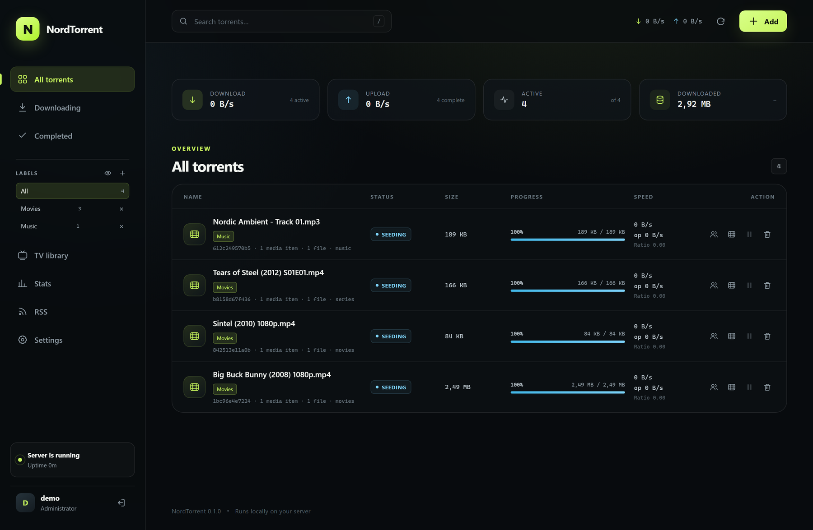
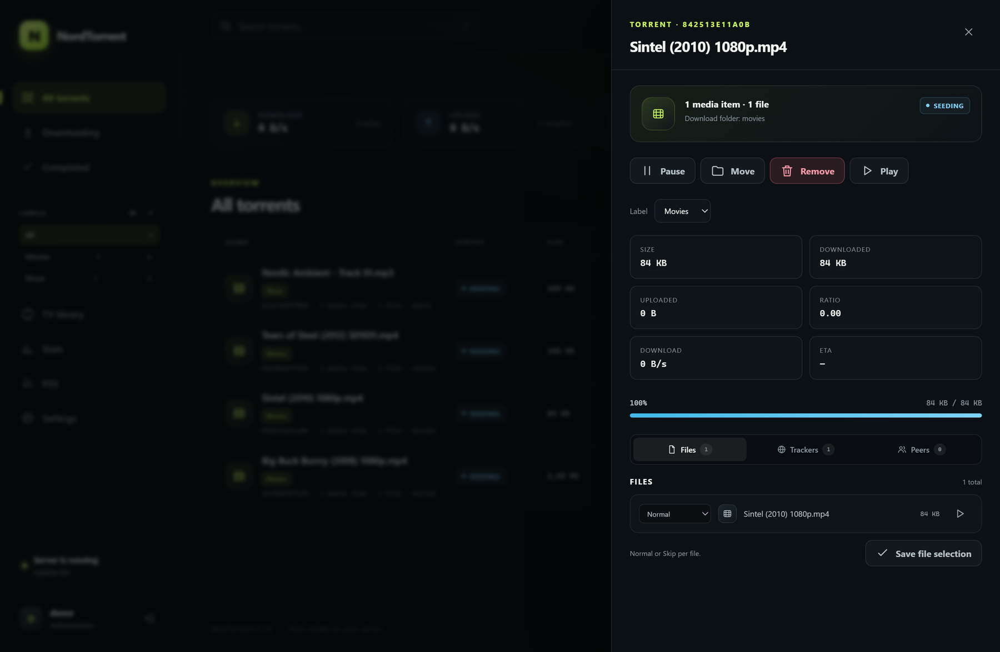
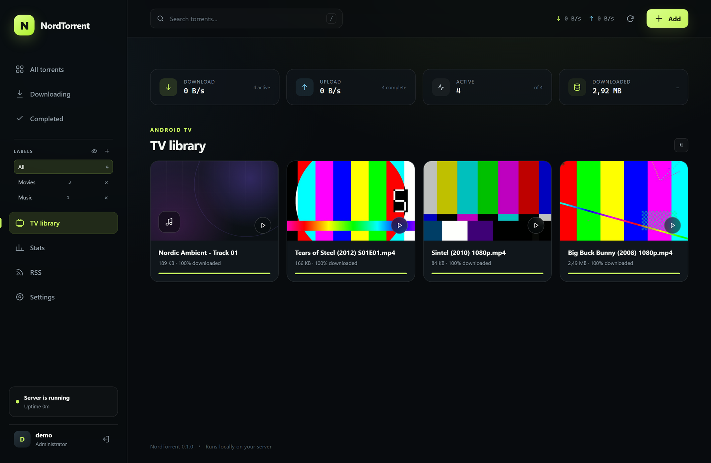
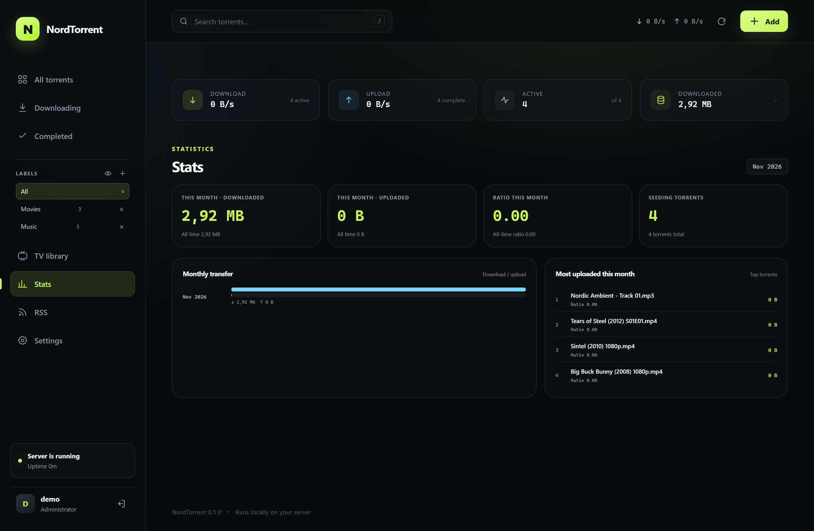
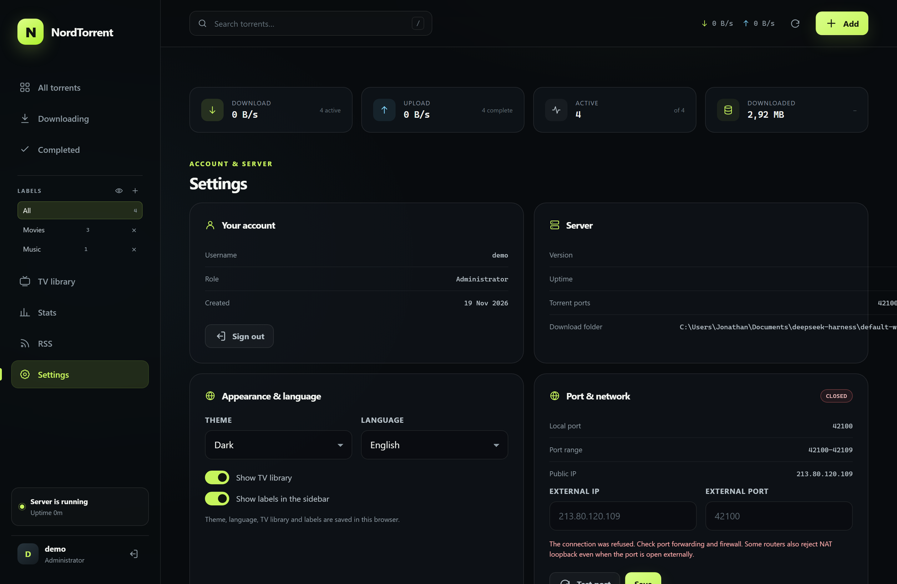
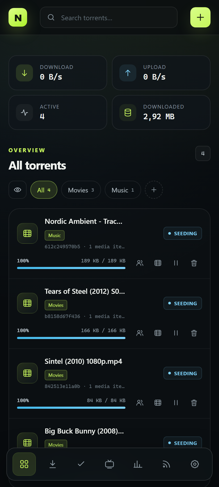
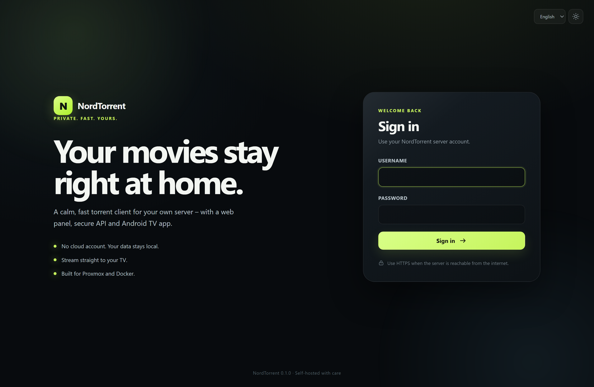
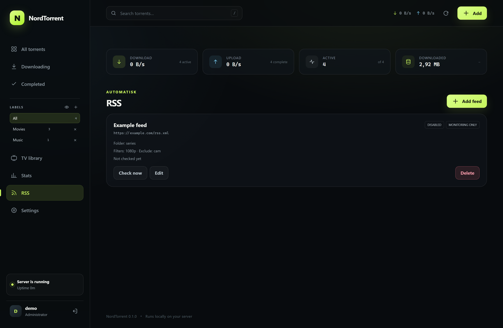

# NordTorrent

En selvhostet torrentklient i Rust med et moderne webpanel, en sikker JSON-API, en Chrome-extension og en native Android TV-app i Kotlin. Bygget til at køre i Docker på en lille hjemmeserver (Proxmox, NAS eller mini-PC) og til at blive brugt på dit eget netværk.

Inspirationen er rtorrent/rutorrent, men overfladen er gjort mere nutidig: mørkt design, tydelig status, ét samlet TV-bibliotek og direkte afspilning af video- og lydfiler via HTTP Range-streaming.

[](https://buymeacoffee.com/jonathannet)

## Skærmbilleder

| Oversigt | Torrent-detaljer |
| --- | --- |
|  |  |

| TV-bibliotek | Statistik |
| --- | --- |
|  |  |

| Indstillinger | Mobil |
| --- | --- |
|  |  |

| Login | RSS |
| --- | --- |
|  |  |

## Funktioner

- **Torrentmotor**: `librqbit` med DHT, trackers, fastresume og session-persistens.
- **Sorterbare kolonner**: klik på Navn, Status, Størrelse, Fremskridt eller Hastighed i torrent-tabellen for at sortere; klik igen for omvendt rækkefølge. Valget huskes pr. browser.
- **Webpanel**: tilføj magnet-links eller `.torrent`-filer, søg, filtrér, pause/genoptag, vælg filer, slet med eller uden filer.
- **Flere downloadmapper**: mounts under `/downloads` vises automatisk ved navn (fx `series2`, `gamle_serier`). Du kan gennemse og søge i undermapper som i rutorrent og vælge den endelige sti, når du tilføjer en torrent.
- **Labels**: opret labels, giv dem en valgfri farve (eller behold den neutrale standard), tildel dem ved tilføjelse eller senere, og filtrér torrentlisten efter label – som labels i ruTorrent. Klik på en label-prik i sidepanelet for at ændre farven.
- **Portstatus**: topbaren viser dit offentlige `IP:port` med grøn/rød/ukendt indikator som i rutorrent. Offentlig IP findes automatisk, og du kan sætte en anden ekstern port (fx routerens `50000 -> 42000`) under **Indstillinger → Port & netværk**.
- **Tema og sprog**: vælg System, Mørk eller Lys samt Dansk eller English under **Indstillinger → Udseende & sprog**. Valget gemmes i browseren, og temaet kan også skiftes direkte på login-skærmen.
- **Direkte links**: siderne har egne URL'er som `/settings`, `/library`, `/downloading`, `/completed`, `/rss` og `/stats`. Reload, back/forward og bogmærker bevarer den side, du står på.
- **Torrent-detaljer**: klik på en torrent for at åbne Filer, Trackere og Peers. Peer-listen vises live, tracker-URL'er hentes fra torrentens metadata, og filer kan sættes til Normal eller Spring over.
- **Sessioner**: administratorer kan se alle aktive enheder/browsere, se IP og seneste aktivitet samt tilbagekalde en session efter en advarselsdialog. Sessioner gemmes i `/data/sessions.json`.
- **Statistik**: upload/download/ratio bevares på tværs af genstarter i `/data/torrent-stats.json`, og ratio vises også i torrent-oversigten. Stats-siden tilføjer månedlig download/upload/ratio, seedende torrents, 6-måneders historik og de mest uploadede torrents.
- **Mappestruktur**: multi-fil torrents opretter en mappe med torrentens navn under den valgte downloadmappe, som rTorrent/ruTorrent. Enkeltfiler gemmes direkte i den valgte mappe.
- **Flyt torrent**: admin kan flytte en torrent til en anden downloadmappe. Torrenten pauses, filerne flyttes (også mellem Docker-mounts), og torrenten genindlæses og startes igen.
- **Hastighedsgrænser**: admin kan slå globale download- og uploadgrænser til/fra og angive maksimal hastighed i KB/s. Indstillingerne gemmes i `/data/speed-limits.json`.
- **Seeding**: admin kan beholde seeding efter færdiggørelse eller stoppe ved en ratio/tid. Grænserne overvåges automatisk og gemmes i `/data/seeding.json`.
- **DHT**: admin kan slå DHT til/fra. Ændringen gemmes i `/data/dht.json` og anvendes ved næste serverstart.
- **I2P (eksperimentel)**: slå I2P til med en SAM-bro (vært/port, standard `127.0.0.1:7656`), send tracker- og peer-trafik gennem I2P-routerens SOCKS-proxy, vælg mixed mode, og test broen direkte i indstillingerne. NordTorrent viser SAM-version og din `.b32.i2p`-destination. Gemmes i `/data/i2p.json` og anvendes ved næste serverstart.
- **RSS/automatiske downloads**: admin kan tilføje RSS-feeds med mappe, include/exclude-filtre og automatisk download. Feeds tjekkes hvert 15. minut og kan tjekkes manuelt.
- **2FA**: TOTP/Google Authenticator kan slås til pr. konto, inklusive QR-kode til opsætning. Direkte login fra private/lokale netværksadresser springer 2FA over; eksterne login – også via Cloudflare Tunnel eller reverse proxy – kræver koden.
- **Chrome-extension**: `.torrent`-downloads, kopierede magnet-links og manuelle magnet-links kan sendes direkte til serveren via den medfølgende extension i `extension/` – med label og mappevalg. Se [extension/README.md](extension/README.md).
- **Private trackers**: private torrents bruger trackerne fra torrenten, private info-hashes sendes aldrig til offentlige fallback-trackere, og HTTP-trackere får `event=completed` ved 100 %, så seedtime kan registreres. Librqbit er vendored i `vendor/librqbit` og `vendor/librqbit-tracker-comms` med rettelserne.
- **TV-bibliotek**: serveren finder video- og lydfiler i alle torrents og eksponerer dem som et samlet bibliotek. Videofiler får ffmpeg-genererede preview-billeder, som caches i `/data/thumbnails/`.
- **Streaming**: HTTP Range-support, så både browsere og Android TV kan spole i ikke-færdige downloads.
- **Roller**: `admin` kan ændre alt; `viewer` kan se biblioteket og afspille.
- **Sikker adgang**:
  - Argon2id-adgangskoder
  - HMAC-signerede sessionstokens (HttpOnly, SameSite=Strict-cookie til web)
  - Bearer-token til Android TV og API-klienter
  - CSRF-beskyttelse, Origin-kontrol, login-rate-limiting
  - Ingen CORS og ingen tredjeparts-CDN'er
- **Android TV**: native Kotlin-app med D-pad-fokus, Media3/ExoPlayer, fortsæt-afspilning og krypteret token-lagring i Android Keystore. Samme app virker på Android-telefoner. Appen er på engelsk som standard og skifter til dansk på danske enheder.
- **Docker**: multi-stage image, ikke-root bruger, read-only root-filsystem, healthcheck og begrænsede capabilities.

## Download

Færdige builds ligger under [Releases](../../releases):

| Platform | Fil | Bemærkning |
| --- | --- | --- |
| Windows 10/11 x64 | `nordtorrent-<version>-windows-x64.zip` | Udpak og kør `run-nordtorrent.cmd` |
| Linux x64 | `nordtorrent-<version>-linux-x64.tar.gz` | Kør `./nordtorrent` med de miljøvariabler du har brug for, eller brug Docker nedenfor |
| Kilde | `nordtorrent-<version>-source.zip` | Samme indhold som dette repository på det tag |

Du kan også hente kilden via **Code -> Download ZIP** eller klone repositoryet. Hvert `v*`-tag bygges automatisk af GitHub Actions, så Windows- og Linux-binæren altid matcher kilde-arkivet for samme tag. Se [docs/RELEASE.md](docs/RELEASE.md) for release-flowet.

### Windows-buildet

1. Udpak det et fast sted, fx `C:\NordTorrent`.
2. Dobbeltklik på `run-nordtorrent.cmd`.
3. Åbn <http://127.0.0.1:8080> og opret administratoren.

Launcheren holder `data\` og `downloads\` ved siden af exe-filen, så hele installationen kan flyttes som én mappe. Vil du bruge en mediedisk, så ret `NORDTORRENT_DOWNLOAD_DIR` i `cmd`-filen. `README.txt` i zip-filen beskriver firewall, HTTPS og de valgfrie ffmpeg-previewbilleder.
## Hurtig start med Docker

Det publicerede image ligger på Docker Hub:

```bash
docker pull jonathannet/nordtorrent:latest
```


Forudsætning: Docker + Docker Compose på en Linux-maskine (fx en Proxmox-VM eller -LXC med Docker).

```bash
git clone <dit-repo> nordtorrent
cd nordtorrent

mkdir -p data downloads
sudo chown -R 1000:1000 data downloads

cp .env.example .env
# Redigér .env: sæt NORDTORRENT_PUBLIC_URL til fx http://192.168.1.101:8080,
# DATA_DIR til data-mappen og DOWNLOAD_DIR til din mediemappe.

docker compose up -d --build
```

Åbn `http://<server-ip>:8080`. Første gang vælger du en administrator og en adgangskode på mindst 12 tegn.

Vil du bootstrap uden web-opsætning, kan du sætte `NORDTORRENT_ADMIN_USER` og `NORDTORRENT_ADMIN_PASSWORD` i `.env` **inden** første start. Fjern dem igen bagefter.

### Flere downloadmapper / Dockhand

Har du flere diske eller mapper, monteres de som undermapper af `/downloads`:

```yaml
volumes:
  - /mnt/nas1/Series2:/downloads/series2
  - /mnt/nas2/gamle_serier:/downloads/gamle_serier
```

NordTorrent finder selv mountene og viser `series2` og `gamle_serier` i mappe-vælgeren. Klik **Gennemse** for at gå ned i undermapper, søge i den aktuelle mappe og vælge den endelige sti. Der er en færdig stack til Dockhand i [`docker-compose.dockhand.yml`](docker-compose.dockhand.yml).

```bash
# Fra projektroden – byg image og start den mountede stack
docker compose -f docker-compose.dockhand.yml up -d --build
```

### Porte

| Port | Formål |
| --- | --- |
| `8080/tcp` | Webpanel og API |
| `42000-42009/tcp` | Indgående BitTorrent-forbindelser |
| `42000-42009/udp` | Reserveret til peer/DHT-trafik |

Til bedste peer-forbindelser kan containeren køre med `network_mode: host` på en Linux-host. Det anbefales især, hvis du vil seede seriøst. Se [docs/DEPLOY.da.md](docs/DEPLOY.da.md).

## Første opsætning

1. Åbn webpanelet og opret administratoren.
2. Gå til **Indstillinger → Brugere** og opret en `viewer`-konto til TV'et.
3. Tilføj en torrent med **Tilføj**.
4. Når en mediefil er registreret, dukker den op under **TV-bibliotek**.
5. Installér Android TV-appen og log ind med serveradresse, brugernavn og adgangskode.

## Android TV

Appen ligger i [`android-tv/`](android-tv/) og bygges med Gradle:

```bash
cd android-tv
./gradlew :app:assembleDebug
adb install -r app/build/outputs/apk/debug/app-debug.apk
```

På Windows:

```powershell
cd android-tv
.\gradlew.bat :app:assembleDebug
adb install -r app\build\outputs\apk\debug\app-debug.apk
```

Appen kræver Android 6.0 (API 23) eller nyere og er lavet til TV-skærme, men virker også på telefoner. Den bruger serverens API og gemmer bearer-tokenet krypteret med en Android Keystore-nøgle.

Se [android-tv/README.md](android-tv/README.md) for detaljer.

## Chrome-extension

Extensionen i [`extension/`](extension/) fjerner trinnet "download og upload bagefter":

- opdager en `.torrent`-download og åbner et lille NordTorrent-vindue
- annullerer Chromes egen download og uploader torrenten til serveren i stedet
- åbner samme vindue, når du kopierer et magnet-link på en side
- lader dig vælge label og downloadmappe, inklusive undermapper

Indlæs den én gang via `chrome://extensions` → **Udviklertilstand** → **Indlæs upakket** og peg på `extension/`-mappen. Se [extension/README.md](extension/README.md).

## Udvikling

Kræver Rust 1.90+ og en C-toolchain. Testet med Rust 1.99. På Windows skal NASM være tilgængelig, fordi rustls' aws-lc-backend bygger assemblerkode.

```bash
cd server
cargo run
```

Standardstier:

- Data: `./data`
- Downloads: `./downloads`
- Web/API: `http://127.0.0.1:8080`

Frontend er bevidst uden build-step: `web/index.html`, `web/assets/app.js` og `web/assets/styles.css` indlejres i binaryen ved kompilering. Det gør Docker-imaget lille og fjerner et helt JavaScript-økosystem fra angrebsfladen.

Miljøvariabler er dokumenteret i [`.env.example`](.env.example). De vigtigste:

| Variabel | Standard | Beskrivelse |
| --- | --- | --- |
| `DATA_DIR` | `./data` | Docker Compose: host-mappe til brugere, session og DHT |
| `NORDTORRENT_LISTEN` | `0.0.0.0:8080` | Web/API-bind |
| `NORDTORRENT_DATA_DIR` | `./data` | Native/container-intern data-sti; i containeren altid `/data` |
| `NORDTORRENT_DOWNLOAD_DIR` | `./downloads` | Mediebibliotek |
| `NORDTORRENT_DEFAULT_DOWNLOAD_FOLDER` | – | Valgfri standardmappe blandt de fundne downloadmapper |
| `NORDTORRENT_PUBLIC_URL` | – | Ekstern URL til Origin-kontrol |
| `NORDTORRENT_EXTERNAL_IP` | auto | Overstyr offentlig IP (ellers findes den via ipify) |
| `NORDTORRENT_EXTERNAL_PORT` | lokal port | Ekstern router-port, fx `50000` |
| `NORDTORRENT_IP_LOOKUP_URL` | `https://api.ipify.org` | Tjeneste til auto-opdagelse af offentlig IP |
| `NORDTORRENT_COOKIE_SECURE` | `false` | Sæt til `true` bag HTTPS |
| `NORDTORRENT_TRUST_PROXY` | `false` | Honorér `X-Forwarded-*` |
| `NORDTORRENT_SESSION_HOURS` | `720` | Levetid for session |

## API

API'et er versioneret under `/api/v1` og returnerer JSON. Android-appen og Chrome-extensionen bruger samme API som webpanelet.

```bash
curl -s http://127.0.0.1:8080/api/v1/status
curl -s -H 'Content-Type: application/json' \
  -d '{"username":"admin","password":"..."}' \
  http://127.0.0.1:8080/api/v1/auth/login
```

Se [docs/API.da.md](docs/API.da.md) for alle endpoints, eksempler og streaming-headere. Den engelske version ligger i [docs/API.md](docs/API.md).

## Sikkerhed

Læs [SECURITY.md](SECURITY.md) før du eksponerer serveren uden for hjemmenetværket. Kort version:

- Kør **altid HTTPS** via en reverse proxy, når serveren kan nås fra internettet.
- Åbn ikke port `8080` direkte i din router.
- Brug en `viewer`-konto til TV'et.
- Tag backup af `data/` – især `users.json` og `session-secret`.
- BitTorrent-trafik er ikke gjort hemmelig af NordTorrent; brug VPN, hvis det er et krav.

## Projektstruktur

```
nordtorrent/
├── server/          Rust-backend (axum, librqbit, auth, API, streaming)
├── web/             Webpanel uden build-step (indlejres i binaryen)
├── android-tv/      Kotlin/Android TV-app
├── extension/       Chrome-extension (Manifest V3)
├── vendor/          Vendored librqbit-crates med private-tracker-rettelser
├── docs/            API-, deploy- og udviklerdokumentation
├── deploy/          Eksempel på Caddy TLS-proxy
├── Dockerfile
└── docker-compose.yml
```

## Status og begrænsninger

Dette er en fungerende første version, ikke en færdig erstatning for alle rtorrent-funktioner. Følgende er bevidst ikke med endnu:

- undertekst-håndtering og burn-in
- transkodning (TV'en afspiller de codecs, ExoPlayer understøtter)
- passkeys (TOTP-to-faktor er understøttet)
- flere servere i samme panel
- detaljeret båndbreddeplanlægning ud over globale hastighedsgrænser
- porttjek er best-effort: det tester fra serveren mod den offentlige IP/port, så NAT-loopback kan give "ukendt", selv om portforwarding virker

## Støt projektet

NordTorrent er et hobbyprojekt bygget om aftenen og i weekenderne. Hvis det har erstattet ruTorrent for dig, eller bare sparet dig en aften med opsætning, kan du købe mig en kaffe – det går til testdiske, kaffe og den årlige domænefornyelse.

[](https://buymeacoffee.com/jonathannet)

Der er ingen betalingsmur, og intet holdes tilbage: hele klienten er MIT-licenseret.

## Licens

MIT – se [LICENSE](LICENSE). Brug kun klienten til materiale, du har ret til at downloade og dele.
