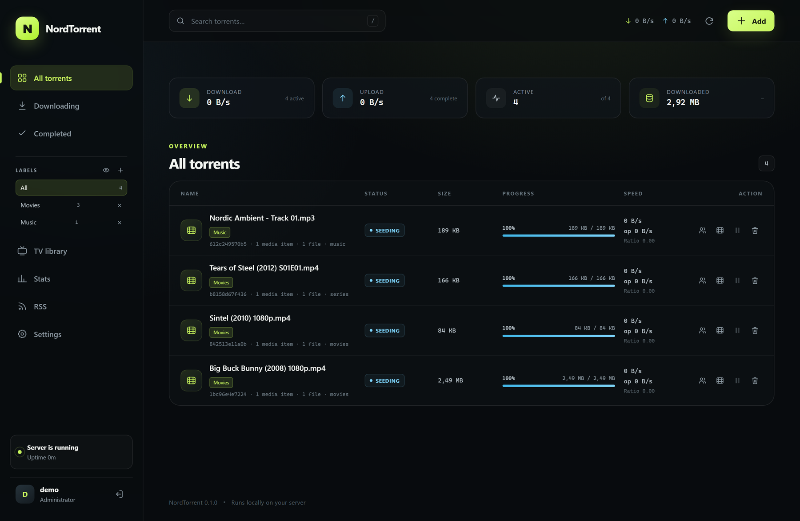
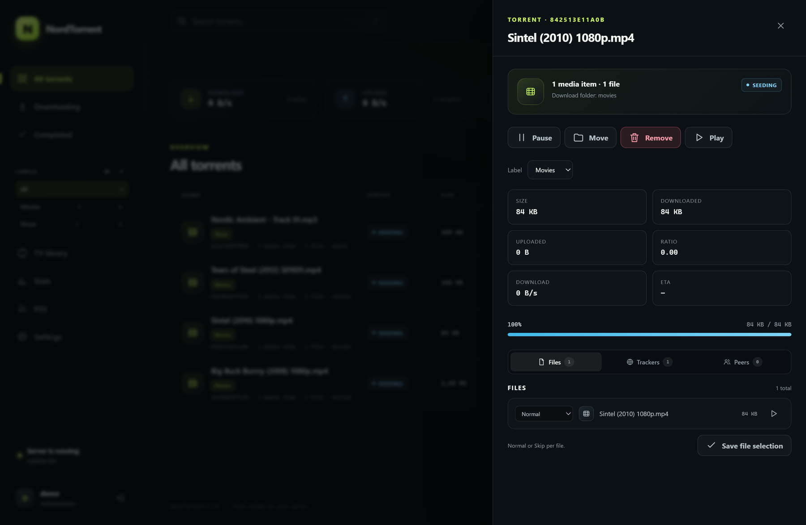
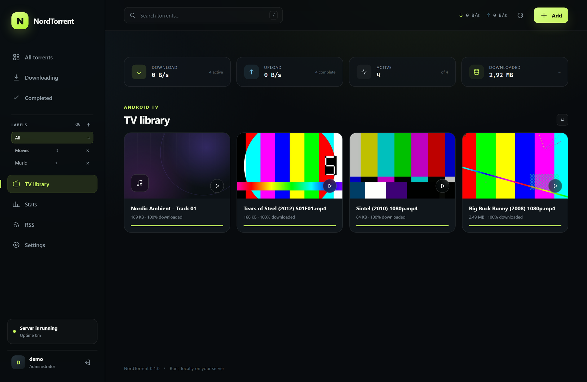
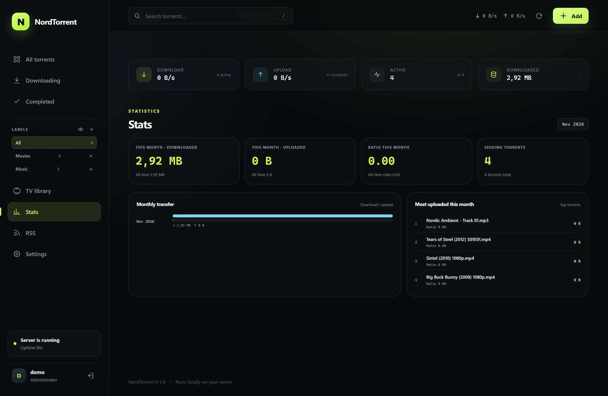
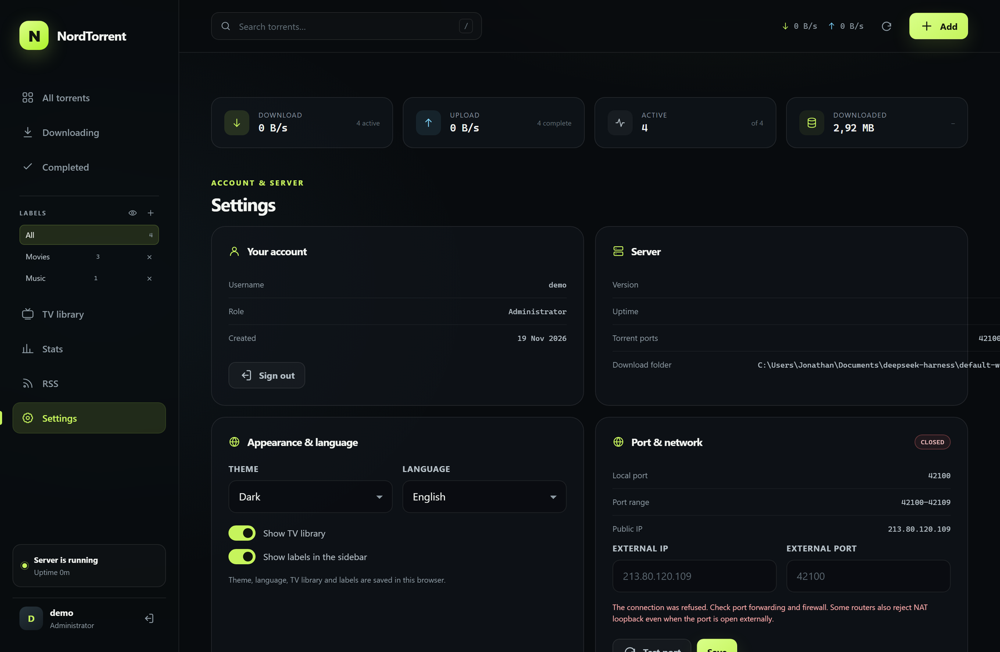
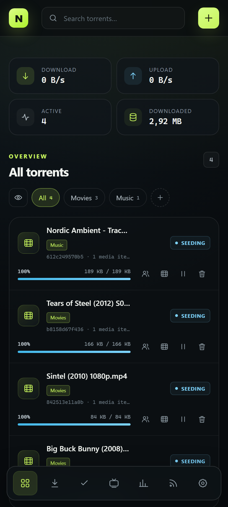
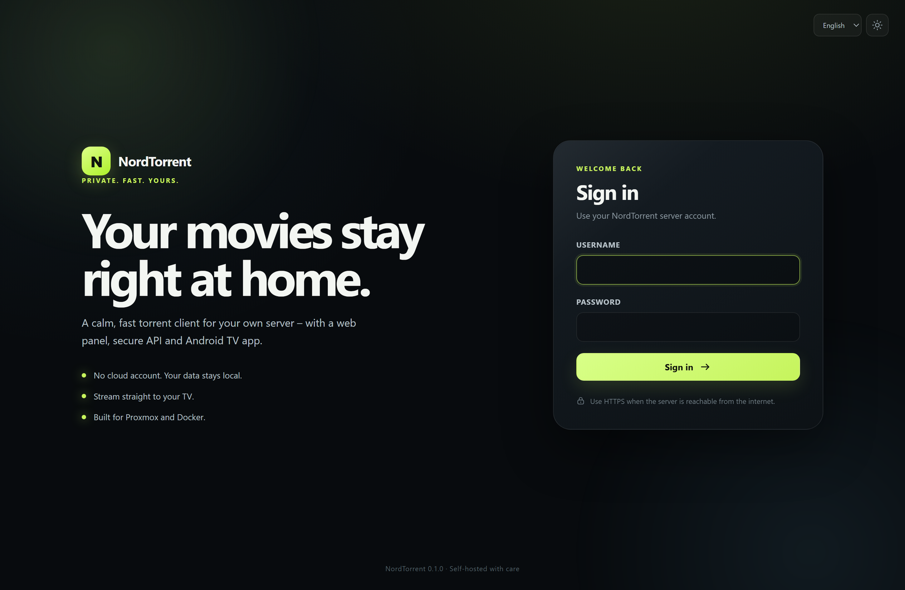
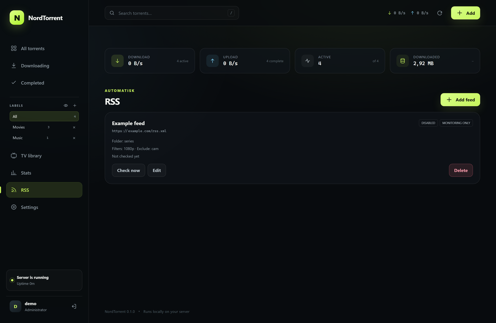

# NordTorrent

A self-hosted torrent client written in Rust with a modern web panel, a secure JSON API, a Chrome extension and a native Android TV app. It is built to run in Docker on a small home server (Proxmox, NAS, mini PC) and to be used on your own network.

Think of it as a headless replacement for rTorrent/ruTorrent: same idea, but with a modern interface, one unified library for your TV, and direct playback of video and audio over HTTP Range streaming.

[](https://www.rust-lang.org/)
[](https://www.docker.com/)
[](LICENSE)
[](https://buymeacoffee.com/jonathannet)

## Screenshots

| Overview | Torrent details |
| --- | --- |
|  |  |

| TV library | Statistics |
| --- | --- |
|  |  |

| Settings | Mobile |
| --- | --- |
|  |  |

| Login | RSS automation |
| --- | --- |
|  |  |

## Features

- **Torrent engine**: `librqbit` with DHT, trackers, fast resume and session persistence.
- **Web panel**: add magnet links or `.torrent` files, search, filter, pause/resume, pick files and delete with or without data.
- **Multiple download folders**: mounted folders under `/downloads` are discovered automatically by name (for example `series2`, `old_shows`). Browse and search subfolders rutorrent-style and choose the exact destination when adding a torrent.
- **Labels**: create labels, give them an optional colour (or keep the neutral default), assign them on add or later, and filter the torrent list by label — like the labels in ruTorrent. Click a label dot in the sidebar to change its colour.
- **Port status**: the top bar shows your public `IP:port` with a green/red/unknown indicator. The public IP is discovered automatically, and you can configure a forwarded external port (for example router `50000 -> 42000`) under **Settings -> Port & network**.
- **Theme and language**: System, Dark or Light, plus Danish or English under **Settings -> Appearance & language**. The choice is stored in the browser, and the theme can also be switched from the login screen.
- **Direct links**: pages have their own URLs (`/settings`, `/library`, `/downloading`, `/completed`, `/rss`, `/stats`), so reload, back/forward and bookmarks keep you in place.
- **Torrent details**: click a torrent to open Files, Trackers and Peers. The peer list is live, tracker URLs come from the torrent metadata, and files can be set to Normal or Skip.
- **Sessions**: administrators can list every active device/browser with IP and last activity, and revoke a session after a warning dialog. Sessions are stored in `/data/sessions.json`.
- **Statistics**: upload/download/ratio survive restarts in `/data/torrent-stats.json`, and the ratio is also shown in the torrent list. The Stats page adds monthly download/upload/ratio, seeding torrents, six-month history and the most uploaded torrents.
- **Folder layout**: multi-file torrents create a folder named after the torrent inside the chosen download folder, just like rTorrent. Single-file torrents are stored directly in the chosen folder.
- **Move torrent**: admins can move a torrent to another download folder. It is paused, forgotten by the engine, the files are moved (also across Docker mounts), and the torrent is added again on the new path and resumed.
- **Speed limits**: admins can toggle global download and upload limits and set a maximum in KB/s. Stored in `/data/speed-limits.json`.
- **Seeding rules**: keep seeding after completion, or stop at a ratio/time. A background monitor enforces the limits and state is stored in `/data/seeding.json`.
- **DHT toggle**: enable or disable DHT from the settings. Stored in `/data/dht.json` and applied on the next server start.
- **RSS automation**: add feeds with a destination folder, include/exclude filters and automatic downloads. Active feeds are checked every 15 minutes and can be checked on demand.
- **Two-factor authentication**: TOTP/Google Authenticator can be enabled per account, including a QR code for setup. Direct logins from private/local addresses skip 2FA; external logins - including anything arriving through a Cloudflare Tunnel or reverse proxy - require the code.
- **Chrome extension**: send `.torrent` downloads, copied magnet links and manual magnet links straight to the server from the bundled extension in [`extension/`](extension/), including labels and folder selection.
- **Private trackers**: private torrents use the trackers embedded in the torrent, private info hashes are never sent to public fallback trackers, and HTTP trackers receive the standard `event=completed` announce at 100% so seed time is recorded. `librqbit` is vendored in `vendor/librqbit` and `vendor/librqbit-tracker-comms` with those fixes.
- **TV library**: the server finds video and audio files across all torrents and exposes them as one library. Videos get ffmpeg-generated preview images cached in `/data/thumbnails/`.
- **Streaming**: HTTP Range support, so both browsers and Android TV can seek inside unfinished downloads.
- **Roles**: `admin` can change everything; `viewer` can browse the library and play.
- **Secure by default**:
  - Argon2id password hashes
  - HMAC-signed session tokens (HttpOnly, SameSite=Strict cookie for the web)
  - Bearer tokens for Android TV and API clients
  - CSRF protection, Origin checks and login rate limiting
  - No CORS and no third-party CDNs
- **Android TV**: native Kotlin app with D-pad focus, Media3/ExoPlayer, resume playback and an encrypted token in Android Keystore. The same app works on Android phones. The UI is in English by default and switches to Danish on Danish devices.
- **Docker**: multi-stage image, non-root user, read-only root filesystem, healthcheck and dropped capabilities.

## Download

Prebuilt binaries are published on the [Releases](../../releases) page:

| Platform | File | Notes |
| --- | --- | --- |
| Windows 10/11 x64 | `nordtorrent-<version>-windows-x64.zip` | Unzip and run `run-nordtorrent.cmd` |
| Linux x64 | `nordtorrent-<version>-linux-x64.tar.gz` | Run `./nordtorrent` with the env vars you need, or use Docker below |
| Source | `nordtorrent-<version>-source.zip` | Identical to this repository at that tag |

You can also grab the source from **Code -> Download ZIP**, or clone the repository. Every `v*` tag is built automatically by GitHub Actions, so the Windows and Linux binaries always match the source archive of the same tag. See [docs/RELEASE.md](docs/RELEASE.md) for the release workflow.

### Running the Windows build

1. Unzip it somewhere permanent, for example `C:\NordTorrent`.
2. Double-click `run-nordtorrent.cmd`.
3. Open <http://127.0.0.1:8080> and create the administrator account.

The launcher keeps `data\` and `downloads\` next to the executable, so the whole install can be moved as one folder. To use a media disk, edit `NORDTORRENT_DOWNLOAD_DIR` in the `cmd` file. `README.txt` in the zip covers the firewall, HTTPS and the optional ffmpeg thumbnails.
## Quick start with Docker

Requirements: Docker and Docker Compose on a Linux machine (a Proxmox VM or LXC with Docker works fine).

```bash
git clone <your-repo> nordtorrent
cd nordtorrent

mkdir -p data downloads
sudo chown -R 1000:1000 data downloads

cp .env.example .env
# Edit .env: set NORDTORRENT_PUBLIC_URL to e.g. http://192.168.1.101:8080,
# DATA_DIR to the data folder and DOWNLOAD_DIR to your media folder.

docker compose up -d --build
```

Open `http://<server-ip>:8080`. On first run you choose an administrator and a password of at least 12 characters.

If you prefer to bootstrap without the web setup, set `NORDTORRENT_ADMIN_USER` and `NORDTORRENT_ADMIN_PASSWORD` in `.env` **before** the first start, then remove them again.

### Multiple download folders

If you have several disks or folders, mount them as subfolders of `/downloads`:

```yaml
volumes:
  - /mnt/nas1/Series2:/downloads/series2
  - /mnt/nas2/old_shows:/downloads/old_shows
```

NordTorrent discovers the mounts and shows `series2` and `old_shows` in the folder picker. Click **Browse** to descend into subfolders, search the current folder and select the exact path. A ready-made Dockhand stack is included in [`docker-compose.dockhand.yml`](docker-compose.dockhand.yml).

```bash
# From the project root - build the image and start the mounted stack
docker compose -f docker-compose.dockhand.yml up -d --build
```

### Ports

| Port | Purpose |
| --- | --- |
| `8080/tcp` | Web panel and API |
| `42000-42009/tcp` | Incoming BitTorrent connections |
| `42000-42009/udp` | Reserved for peer/DHT traffic |

For the best peer connectivity the container can run with `network_mode: host` on a Linux host. This is recommended if you plan to seed seriously. See [docs/DEPLOY.md](docs/DEPLOY.md).

## First run

1. Open the web panel and create the administrator.
2. Go to **Settings -> Users** and create a `viewer` account for the TV.
3. Add a torrent with **Add**.
4. Once a media file is registered it appears under **TV library**.
5. Install the Android TV app and sign in with the server address, username and password.

## Android TV

The app lives in [`android-tv/`](android-tv/) and is built with Gradle:

```bash
cd android-tv
./gradlew :app:assembleDebug
adb install -r app/build/outputs/apk/debug/app-debug.apk
```

On Windows:

```powershell
cd android-tv
.\gradlew.bat :app:assembleDebug
adb install -r app\build\outputs\apk\debug\app-debug.apk
```

The app requires Android 6.0 (API 23) or newer. It uses the server API and stores the bearer token encrypted with an Android Keystore key. The same APK runs on Android phones and adapts its layout.

See [android-tv/README.md](android-tv/README.md) for details.

## Chrome extension

The extension in [`extension/`](extension/) removes the "download then upload" step:

- detects a `.torrent` download and opens a small NordTorrent window
- cancels Chrome's own download and uploads the torrent to the server instead
- opens the same window when you copy a magnet link on a page
- lets you pick a label and a destination folder, including subfolders

Load it once via `chrome://extensions` -> **Developer mode** -> **Load unpacked** and point it at the `extension/` folder. See [extension/README.md](extension/README.md).

## Development

Requires Rust 1.90+ and a C toolchain. Tested with Rust 1.99. On Windows, NASM must be available because the rustls aws-lc backend builds assembly.

```bash
cd server
cargo run
```

Default paths:

- Data: `./data`
- Downloads: `./downloads`
- Web/API: `http://127.0.0.1:8080`

The frontend intentionally has no build step: `web/index.html`, `web/assets/app.js` and `web/assets/styles.css` are embedded into the binary at compile time. That keeps the Docker image small and removes an entire JavaScript ecosystem from the attack surface.

Environment variables are documented in [`.env.example`](.env.example). The most important ones:

| Variable | Default | Description |
| --- | --- | --- |
| `DATA_DIR` | `./data` | Docker Compose: host folder for users, sessions and DHT |
| `NORDTORRENT_LISTEN` | `0.0.0.0:8080` | Web/API bind address |
| `NORDTORRENT_DATA_DIR` | `./data` | Native/container-internal data path; inside the container always `/data` |
| `NORDTORRENT_DOWNLOAD_DIR` | `./downloads` | Media library |
| `NORDTORRENT_DEFAULT_DOWNLOAD_FOLDER` | - | Optional default folder among the discovered download folders |
| `NORDTORRENT_PUBLIC_URL` | - | External URL used for Origin checks |
| `NORDTORRENT_EXTERNAL_IP` | auto | Override the public IP (otherwise discovered via ipify) |
| `NORDTORRENT_EXTERNAL_PORT` | local port | External router port, e.g. `50000` |
| `NORDTORRENT_IP_LOOKUP_URL` | `https://api.ipify.org` | Service used for public IP discovery |
| `NORDTORRENT_COOKIE_SECURE` | `false` | Set to `true` behind HTTPS |
| `NORDTORRENT_TRUST_PROXY` | `false` | Honour `X-Forwarded-*` headers |
| `NORDTORRENT_SESSION_HOURS` | `720` | Session lifetime |

## API

The API is versioned under `/api/v1` and returns JSON. The Android app and the Chrome extension use the same API as the web panel.

```bash
curl -s http://127.0.0.1:8080/api/v1/status
curl -s -H 'Content-Type: application/json' \
  -d '{"username":"admin","password":"..."}' \
  http://127.0.0.1:8080/api/v1/auth/login
```

See [docs/API.md](docs/API.md) for every endpoint, examples and streaming headers. A Danish version is available in [docs/API.da.md](docs/API.da.md).

## Security

Read [SECURITY.md](SECURITY.md) before exposing the server outside your home network. Short version:

- **Always** run HTTPS through a reverse proxy when the server is reachable from the internet.
- Do not open port `8080` directly in your router.
- Use a `viewer` account for the TV.
- Back up `data/`, especially `users.json` and `session-secret`.
- BitTorrent traffic is not anonymised by NordTorrent; use a VPN if that is a requirement.

## Project structure

```
nordtorrent/
├── server/          Rust backend (axum, librqbit, auth, API, streaming)
├── web/             Web panel without a build step (embedded into the binary)
├── android-tv/      Kotlin/Android TV app
├── extension/       Chrome extension (Manifest V3)
├── vendor/          Vendored librqbit crates with private-tracker fixes
├── docs/            API, deployment and developer documentation
├── deploy/          Example Caddy TLS proxy
├── Dockerfile
└── docker-compose.yml
```

## Status and limitations

This is a working first version, not a finished replacement for every rTorrent feature. Deliberately not included yet:

- subtitle management and burn-in
- transcoding (the TV plays the codecs ExoPlayer supports)
- passkeys (TOTP two-factor authentication is supported)
- multiple servers in one panel
- detailed bandwidth scheduling beyond global speed limits
- the port check is best-effort: the server connects to the public IP/port itself, so NAT loopback can report "unknown" even when port forwarding works

## Support

NordTorrent is a hobby project built in evenings and weekends. If it replaced ruTorrent for you, or simply saved you an evening of setup, you can buy me a coffee - it goes towards test disks, a coffee supply and the odd domain renewal.

[](https://buymeacoffee.com/jonathannet)

There is no paywall and nothing is held back: the whole client is MIT licensed.

## License

MIT - see [LICENSE](LICENSE). Only use the client for material you have the right to download and share.
